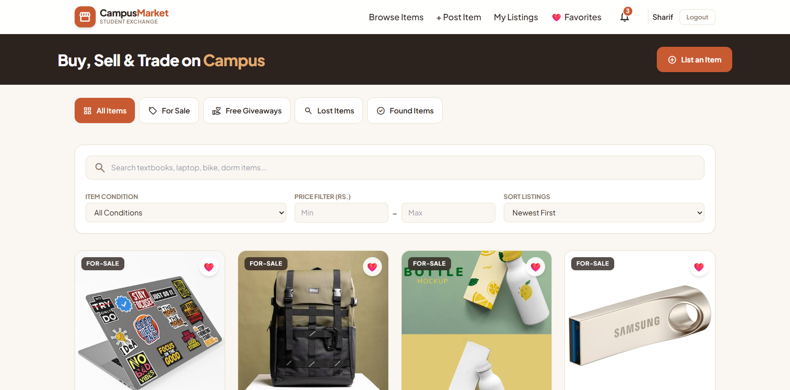
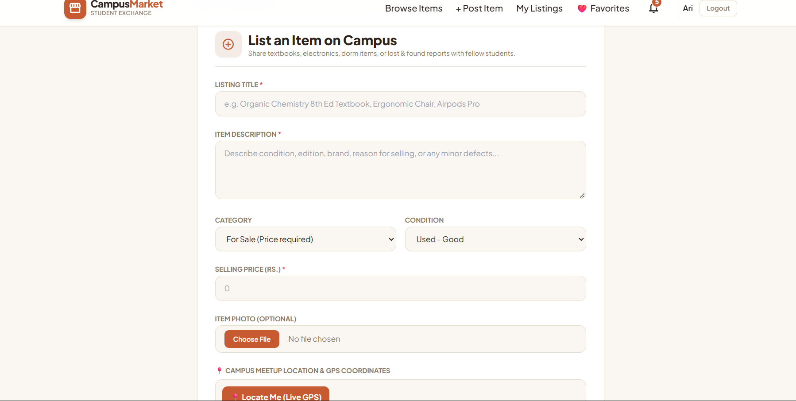
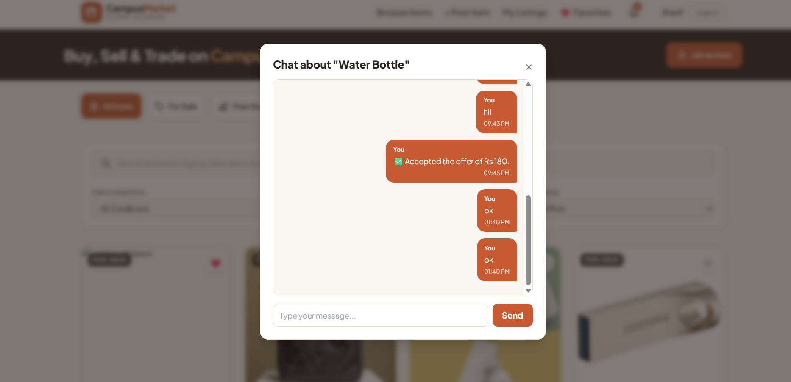
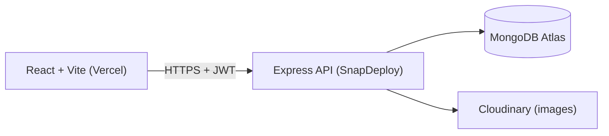

# CampusMarket: Student Exchange


A full-stack marketplace for university students to buy, sell, give away, and report lost and found items, with built-in chat, offers, notifications, and a campus meetup map.

**Live demo:** https://camp-market-rust.vercel.app
**Note:** the backend runs on a free tier and sleeps when idle, so the very first load can take 30 to 60 seconds.







## Features

- **Browse and search:** category filters (for sale, free, lost, found) and title search
- **Post listings** with photo upload (Cloudinary) and a **meetup location** picked from campus spots, live GPS, or by dragging a marker on an interactive map
- **Seller contact details** revealed only to logged-in users
- **Chat** between buyer and seller on each listing
- **Offers:** buyers make offers, sellers accept or decline from the chat
- **Notifications** with an unread badge for messages, interest, and offers
- **Favorites** and **seller ratings and reviews**
- **My Listings:** mark items resolved or delete them
- **Authentication:** register and login with JWT, input validation, and protected routes on both the API and the frontend

## Tech stack

| Layer | Technology |
|---|---|
| Frontend | React, Vite, React Router, Axios, Leaflet, Tailwind utility classes and custom CSS |
| Backend | Node.js, Express, Mongoose |
| Database | MongoDB Atlas |
| Auth and security | JWT, bcrypt, Helmet, restricted CORS, rate limiting on auth routes |
| File storage | Cloudinary (via Multer) |
| Testing | Jest, Supertest |
| CI/CD | GitHub Actions checks on every pull request, Vercel auto-deploy |
| Hosting | Vercel (frontend), SnapDeploy (backend) |

## Architecture



## Project structure

```
campus-marketplace/
├── backend/
│   ├── src/
│   │   ├── config/        # Cloudinary setup
│   │   ├── controllers/   # route logic (auth, listings, messages, ...)
│   │   ├── middleware/    # JWT protect, file upload
│   │   ├── models/        # Mongoose schemas
│   │   └── routes/        # route definitions
│   ├── tests/             # Jest + Supertest tests
│   └── server.js
├── frontend/
│   └── src/
│       ├── api/           # Axios instance (attaches the JWT)
│       ├── components/    # Navbar, modals, map, protected route
│       └── pages/         # Home, Post Item, My Listings, auth pages, ...
└── .github/workflows/     # CI pipeline
```

## API overview

| Method | Endpoint | Auth | Description |
|---|---|---|---|
| POST | `/api/auth/register` | No | Create an account (validated) |
| POST | `/api/auth/login` | No | Log in, returns a JWT |
| GET | `/api/listings` | No | Active listings (`?category=`, `?search=`) |
| GET | `/api/listings/mine` | Yes | Your own listings |
| POST | `/api/listings` | Yes | Create a listing (multipart, with image) |
| PATCH | `/api/listings/:id` | Yes (owner) | Update a listing |
| DELETE | `/api/listings/:id` | Yes (owner) | Delete a listing |
| POST | `/api/listings/:id/respond-offer` | Yes (seller) | Accept or decline an offer |
| GET / POST | `/api/messages/:listingId` | Yes | Read and send chat messages |
| GET | `/api/notifications` | Yes | Your notifications |
| PATCH | `/api/notifications/:id/read` | Yes | Mark one as read |
| PATCH | `/api/notifications/read-all` | Yes | Mark all as read |
| POST | `/api/users/:id/rate` | Yes | Rate and review a seller |

## Running locally

**Requirements:** Node.js 22 or newer, a MongoDB Atlas cluster, and a Cloudinary account.

```bash
git clone https://github.com/Muhammadsharif-21/campus-marketplace.git
cd campus-marketplace
```

**Backend**

```bash
cd backend
npm install
```

Create `backend/.env` (see `backend/.env.example`):

```
PORT=5000
MONGO_URI=your_mongodb_connection_string
JWT_SECRET=a_long_random_string
CLIENT_URL=http://localhost:5173
CLOUDINARY_CLOUD_NAME=your_cloud_name
CLOUDINARY_API_KEY=your_api_key
CLOUDINARY_API_SECRET=your_api_secret
```

```bash
npm run dev
```

**Frontend**

```bash
cd frontend
npm install
```

Create `frontend/.env`:

```
VITE_API_URL=http://localhost:5000/api
```

```bash
npm run dev
```

Open http://localhost:5173.

## Testing

```bash
cd backend
npm test
```

Tests cover registration validation (email, password, phone, missing fields) and verify that protected routes reject requests without a token.

## CI/CD

Every pull request and push to `main` runs GitHub Actions:

- **Backend:** install, syntax check of every source file, and the Jest test suite
- **Frontend:** install and a full production build

When changes are merged to `main`, Vercel redeploys the frontend automatically, and the backend is redeployed on SnapDeploy.

## Security notes

- Passwords are hashed with bcrypt and are never stored or returned in plain text
- JWTs are verified on every protected route, and ownership is checked before editing or deleting
- Login and registration are rate limited, and CORS only allows the frontend's origin
- Secrets live in environment variables and are excluded from git
- Server-side validation of all registration input

## Roadmap

- Real-time chat with WebSockets
- Email or WhatsApp alerts for new messages and offers
- Integration tests against an in-memory database
- Email verification on sign-up
- AI-generated listing descriptions

## Development notes

Built as a learning project to practice full-stack development, authentication, deployment, and CI/CD. Some features were developed with the help of AI coding tools, and I reviewed, debugged, and deployed them myself.

## Author

**Ari** · [GitHub](https://github.com/Muhammadsharif-21) · [LinkedIn](https://www.linkedin.com/in/your-profile)
